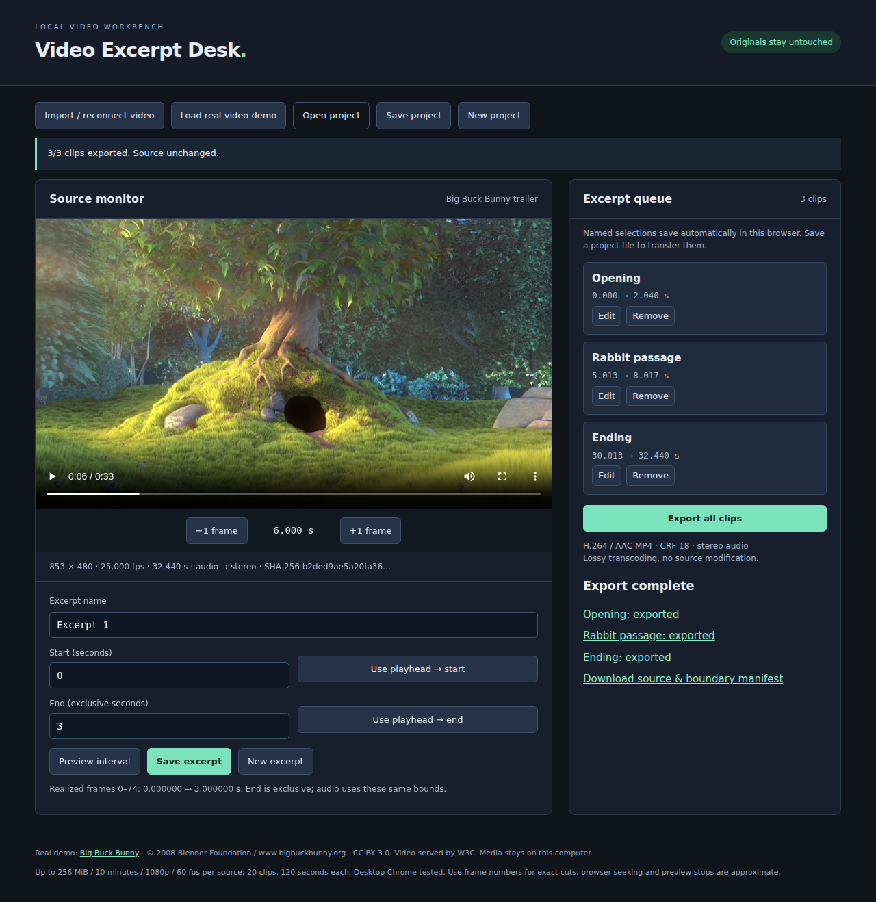

# Video Excerpt Desk

Select passages from a local video, preview them, save named excerpts, and export
MP4 clips with a source hash and an explicit frame-boundary manifest. Originals are
read only; the app works from private local copies.

## Launch

Requires Node.js 22+ and a supported Linux/macOS/Windows FFmpeg binary platform.
On macOS/Linux:

```sh
./launch.sh
```

Open **http://127.0.0.1:4318** in desktop Chrome. First launch installs locked npm
dependencies and downloads an 11 MB licensed real-video demo. On Windows run
`npm ci`, `npm run acquire`, then `npm start`. FFmpeg binaries install through the
pinned npm packages; first setup requires network access, later use is local.
No account, cloud processing, or paid service is needed.

1. Choose **Load real-video demo**, or **Import / reconnect video**.
2. Play or step the source, enter start/end seconds, and name a passage. **Preview
   interval** plays the selection. **Save excerpt** adds it to the queue. **Edit**
   changes a saved selection; **New excerpt** leaves existing selections intact.
3. **Export all clips** transcodes each selection. Open each output link in the
   browser's separate player; use its download menu to save the MP4. Download the
   manifest for source identity, requested/realized bounds, settings and hashes.
4. Selections survive reload in browser storage. **Save project** downloads a
   portable JSON file. On another machine, **Open project**, then reconnect the
   identical original file. A missing or different hash blocks export and leaves
   the saved selections intact. **New project** explicitly resets the workspace.



Demo attribution: **(c) copyright 2008, Blender Foundation / www.bigbuckbunny.org**,
[CC BY 3.0](https://creativecommons.org/licenses/by/3.0/). See [provenance](demo/LICENSE.md).

## Supported scope and timing

Supported input is MP4 with exactly one H.264 SDR yuv420p video track and zero or
one AAC audio track. No subtitles, additional tracks, rotation, HDR, irregular
presentation timestamps, or variable frame rate. Tracks must start at time zero;
audio must cover the video. Limits: 256 MiB, 10 minutes, 1920×1080 total pixel count,
1–60 fps; up to 20 clips of at most 120 seconds. Import decodes frame timestamps to
check constant frame rate, so it can take several seconds. Processing has a
three-minute timeout per media command. Chrome for Testing 141.0.7390.122 on Linux x64 is tested;
other browsers and OS builds are not validated. Browser H.264/AAC support is required.

Selections are **[start,end)** in source presentation seconds. The exporter keeps
video frames whose timestamps are at or after start and strictly before end.
For example, at 25 fps, `5.013 → 8.017` realizes `5.040 → 8.040` (frames 126–200,
zero based). Both bounds round forward by less than one frame. Audio is trimmed
to the same realized bounds, retaining synchronization relative to the source.
Video duration is decoded frame count / fps; an audio-only tail is not selectable.
Browser seeks/frame-step display and preview stopping are approximate; exported
frame selection is authoritative. An interval containing no video frame fails.

Output is lossy H.264 CRF 18 / fast preset, yuv420p, AAC 192 kbit/s stereo at 48 kHz.
Multichannel audio is downmixed. Odd dimensions receive right/bottom padding to
even dimensions. Source metadata is stripped. There is no lossless/keyframe-copy
mode. Unique batch directories and numeric clip prefixes prevent name collisions;
user names cannot select filesystem paths. Every requested clip receives exported
or failed status; a mixed batch is explicitly partial. In-progress files are not
served. Interrupted processes can leave ignored partial files; do not treat those
as completed exports. There is no resume/cancel feature or durable job queue.
Keep the page open during export; completed manifests remain in `.workspace/exports/`.

Browser project files contain selection metadata, not video bytes. Imported media
is stored by hash in `.workspace/sources/`. Restarting the server revalidates stored
sources; reconnect and export hash them again. Do not edit the app's copies while
operations run. The server listens only on loopback and rejects foreign origins;
it is a single-user local tool, not a hosted multi-user service. Delete `.workspace/`
and clear browser storage to erase local copies and selections. Back up project
JSON and original media separately.

## Reproduce validation

```sh
npm ci --cache /tmp/video-excerpt-npm
npm run acquire
npm test
python3 scripts/install-test-browser.py
npm run test:browser
node scripts/verify-demo.js
node scripts/controls.js
```

The browser test requires a codec-enabled Chrome. Playwright’s bundled Chromium
in this environment lacks H.264/AAC, so the Linux x64 setup script downloads a
pinned Chrome for Testing archive to `/tmp` and verifies its SHA-256. Python 3 is
required for this test-only setup. On other platforms set `VIDEO_BROWSER` to a
compatible Chrome executable. The production app does not download a browser.

The browser test imports real footage, saves three named clips (beginning,
non-keyframe interior, and end), previews/edits, reloads, transfers the JSON into a
fresh context, exports, and plays every output in a standalone browser player.
It also checks missing/mismatched sources. A visible screenshot and machine-readable
reports are in `results/`. Large source and exported videos remain ignored and
are regenerated by these commands.

[Prospective tolerances](demo/tolerances.json) are separate from the verifier.
`scripts/verify.js` independently reads source presentation timestamps and decodes
first/last output frames to compare against source frames. It checks exact frame
count, video/container duration, hashes and audio cross-correlation at the head,
middle and tail of every real-demo clip. Silent windows are inconclusive, not
alignment evidence. The separate implementation shares the FFmpeg decoder with
the exporter; it is not an independent codec implementation. Audio checks measure
preservation of source A/V timing, not the original production's synchronization.
Frame image comparisons are reduced-resolution and cannot prove pixel identity.
The declared image tolerance accommodates lossy encoding, not wrong-frame cuts.
Generated testsrc controls supplement real media: beginning/end, non-keyframe,
absent audio, and explicit VFR rejection. They are labeled synthetic.

## Existing work

[LosslessCut](https://github.com/mifi/lossless-cut) already provides extensive
FFmpeg-based clipping workflows, including lossless operations. This small local
browser workbench does not claim novelty or feature parity. Its narrow emphasis
is named persistent selections and auditable, decoded-frame-based transcoding.
Implementation semantics follow FFmpeg's documented
[trim/atrim filters](https://ffmpeg.org/ffmpeg-filters.html#trim).
