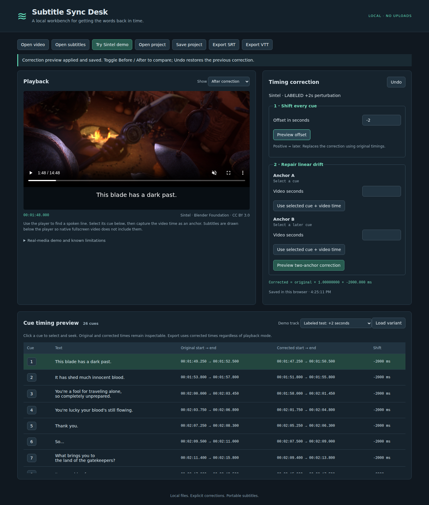

# Subtitle Sync Desk

Repair subtitles that start late or drift over time, compare them against a local video, and export corrected SRT or WebVTT. Files stay on your machine. No accounts, API keys, uploads or paid services.

## Launch

Install Node.js 20 or newer, then run from this directory:

```sh
npm start
```

Open **http://127.0.0.1:4173**. There are no runtime npm dependencies. Open a video and a UTF-8 `.srt` or `.vtt` file. MP4 with H.264/AAC works in the tested Chromium browser. Other codecs depend on your browser.

## Repair a track

1. Select a cue number to seek to it. Use the video controls to find the actual spoken line.
2. For a constant shift, enter seconds under **Shift every cue** and select **Preview offset**. Positive values move subtitles later; negative values move them earlier.
3. For drift, select an early cue, position playback at the beginning of its spoken line and capture **Anchor A**. Repeat with a later cue for **Anchor B**. You can type precise video seconds after capture. Select **Preview two-anchor correction**.
4. Compare **Before correction** and **After correction**, and inspect both sets of times in the table. Every correction is relative to the imported original, not compounded with the last preview. **Undo** restores the previous correction.
5. Export **SRT** or **VTT**. **Save project** additionally preserves original text, timing and correction history. Browser storage automatically recovers the latest edits on reload; reselect your video. Import a saved project to move work between browsers or recover after storage is cleared.

Negative times, nonpositive durations and unordered starts block subtitle export; cues are retained and project export stays available. Overlaps are warnings, because simultaneous dialogue can be intentional. Linear correction cannot repair arbitrary cuts or nonlinear changes. The app does not edit subtitle text.

## Real-film demo

Install Python 3.11+, `curl`, and FFmpeg using your usual local tools. Acquire the full official Sintel film (about 650 MB download, about 2 GB working disk space including ZIP, MKV and MP4):

```sh
python3 scripts/acquire_demo.py
npm start
```

Choose **Try Sintel demo**. Acquisition checks pinned source hashes, copies the video without cuts, converts English audio to AAC, and retains all credits. Large media is ignored by Git. See [provenance and license](docs/provenance.md).

For an external media directory:

```sh
python3 scripts/acquire_demo.py /tmp/subtitle-sync-media
SUBTITLE_MEDIA_DIR=/tmp/subtitle-sync-media npm start
```

To demonstrate a known repair:

- Choose **Labeled test: +2 seconds**, then **Load variant**. Apply an offset of `-2`. At video second `108`, Before has no caption and After shows the first line.
- Choose **Labeled test: 1% drift +2 seconds**, then **Load variant**. Select cue **1**, capture A and set its video time to `107.250`. Select cue **26**, capture B and set its video time to `626.200`. Preview the two-anchor correction. These are known baseline anchors for an intentionally perturbed track, not measured speech onsets. Compare near `108`, `446` and `627` seconds. Exported timings recover the source to within 1 ms.



Sintel image and subtitles: © copyright Blender Foundation | durian.blender.org · [CC BY 3.0](https://durian.blender.org/sharing/). Screenshot shows an explicitly perturbed source track after repair.

## Supported file subset and limits

- UTF-8, optional BOM; LF or CRLF. Files up to 8 MiB; 1–20,000 cues, up to 10,000 characters per cue.
- SRT: consecutive numeric identifiers starting at 1, `HH:MM:SS,mmm --> HH:MM:SS,mmm`, then nonempty plain text. Multiline text, punctuation, Unicode and spaces inside text are preserved. Blank lines separate cues.
- WebVTT: exactly `WEBVTT` plus a blank line, optionally sequential numeric cue identifiers, `HH:MM:SS.mmm` or `MM:SS.mmm` times. No header metadata, NOTE/STYLE/REGION blocks, positioning/settings, custom identifiers, tags, entities, karaoke or other markup. Unsupported constructs fail explicitly; nothing is silently stripped. Exports use canonical consecutive numeric identifiers and LF separators.
- Times are integer milliseconds; affine results round to the nearest millisecond. In the demo, source perturbation also rounds to milliseconds. The declared recovery tolerance is 1 ms per endpoint.
- One project auto-saves per browser origin. Private browsing, storage quotas, cleared site data or a different port can prevent recovery. Keep project-file backups. Video bytes and anchor input fields are not saved; applied corrections and up to 100 history states are saved. Multiple simultaneous tabs are not coordinated.
- Captions appear below the video. Native fullscreen and picture-in-picture show only the video; keep the workbench visible for subtitle preview. Preview updates follow browser media events, not a frame-accurate editing clock. Background tabs may throttle events.
- Tested on desktop headless Chromium, including a narrow viewport. Safari, Firefox, mobile hardware and every possible local codec have not been validated.

## Verification

```sh
npm ci
npm test
npx playwright install chromium
SUBTITLE_MEDIA_DIR=/tmp/subtitle-sync-media npm run test:browser
python3 -m venv /tmp/subtitle-checks
/tmp/subtitle-checks/bin/pip install -r tests/requirements.txt
/tmp/subtitle-checks/bin/python tests/independent_exports.py
```

Browser tests start their own server on loopback port 4174 and save actual downloads, screenshots and observations to `/tmp/subtitle-sync-evidence` (override with `SUBTITLE_TEST_OUTPUT`). The independent Python check compares those downloads and Chromium's native WebVTT parse against the original track, without importing app code. Use its optional directory argument if you change the output location.

[Recorded validation and dialogue inspection](docs/validation.md) distinguish exact recovery of artificial perturbations from approximate audio-based checks of real dialogue. They are not a claim of frame-accurate synchronization across arbitrary films.

## Existing work

[Subtitle Edit](https://github.com/SubtitleEdit/subtitleedit) and [Aegisub](https://aegisub.org/) are established subtitle editors with broader functionality. This project offers a small local-browser timing workflow, not a new synchronization algorithm. Its affine mapping is `target = original × scale + offset`, with scale and offset solved from two corresponding points.
