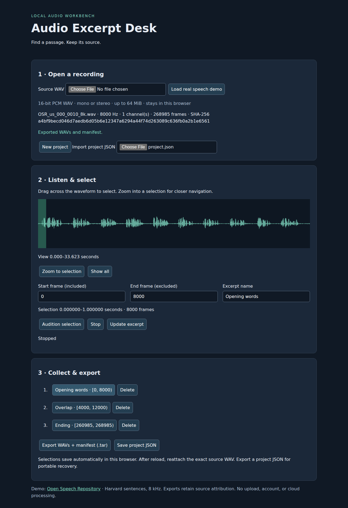

# Audio Excerpt Desk

A local browser workbench for selecting and auditioning named passages, then exporting sample-exact WAV excerpts with source references.

## Launch

Requires Python 3 and npm; no runtime npm dependencies:

```sh
npm start
```

Open **http://127.0.0.1:18765** and click **Load real speech demo**. The command downloads a hash-pinned 33.6-second speech recording on first use. For offline use with your own WAV, run `python3 scripts/serve.py` instead. All source media stays in the browser; the server only serves static files and the public demo.

1. Open a WAV or load the demo. Drag the waveform or enter exact sample-frame boundaries. Zoom to selection / Show all changes the visible region.
2. Audition the selection, give it a name, and save it. Click a saved excerpt to edit and update it. Overlap is allowed.
3. Export a `.tar` archive containing numbered WAV files and `manifest.json`. Extract using your archive utility or `tar -xf excerpts.tar`.
4. Reload and reattach the same source to recover selections. Save project JSON for a portable backup; import it and reattach the source on another browser. A mismatched hash is rejected. New project clears the browser's current saved project.



## Exactness and limits

Only little-endian RIFF WAVE format-code 1, signed 16-bit PCM, mono/stereo, 8–96 kHz is supported. MP3, floating-point, extensible WAV, RF64 and other encodings are explicitly rejected. Input limit: 64 MiB; 100 excerpts; combined export PCM limit: 128 MiB. Processing is in memory and long files may stall the interface. This is a single-source, single-project workbench, with no effects, mixing, transcription, or destructive audio edits.

Boundaries are half-open **sample frames** `[start,end)`, each containing all channels. Numeric entries must be integers. Waveform pointer positions round to the nearest frame; displayed seconds are informational. WAV exports copy original interleaved sample bytes, with no normalization, dithering, decoding conversion, resampling, or metadata-chunk retention. Output headers retain source sample rate and channel count. The manifest records full-source SHA-256, dimensions, excerpt names, filenames, bounds, and output SHA-256. Unknown RIFF chunks are skipped with padding; malformed/truncated input is rejected.

Audition converts int16 samples to float32 for Web Audio; the audio device/browser may resample **playback only**. Tests exercise Chromium Web Audio start and natural completion; no human listening or speaker-output measurement is claimed. Firefox and Safari have not been tested. Use localhost (secure context) for hashing. Automatic recovery uses localStorage for selections only, never source bytes; storage clearing/private browsing can lose it. Keep project JSON backups. Reattach exact bytes, even when only a WAV metadata chunk changed. One active tab is recommended; concurrent tabs do not synchronize. Project JSON is metadata, not a media backup.

## Reproduce verification

```sh
python3 scripts/demo.py
npm ci --cache /tmp/audio-npm
PLAYWRIGHT_BROWSERS_PATH=/tmp/audio-browsers npx playwright install chromium
PLAYWRIGHT_BROWSERS_PATH=/tmp/audio-browsers npm test
python3 scripts/verify.py data/demo.wav data/exports/real.tar
python3 scripts/verify.py data/stereo.wav data/exports/stereo.tar
```

Browser tests cover real-recording load, pointer selection/zoom, editing, audition completion, reload, portable import/export, changed-source rejection, empty/out-of-range rejection and archive export. Python's separate standard-library WAV decoder verifies every exported frame against the source, including beginning/end and overlap. A distinctly patterned synthetic stereo fixture tests channel preservation and one-frame edges; it is supplemental, not the real-use demo. Downloaded media and generated archives stay under ignored `data/`.

## Prior work and format references

This is a bounded convenience workflow, with no novelty claim. [Audacity's export workflow](https://manual.audacityteam.org/man/file_export_dialog.html) already supports selection and multiple-file export. This workbench focuses on small local PCM recordings and traceable frame boundaries. [McGill's WAVE reference](https://www.mmsp.ece.mcgill.ca/Documents/AudioFormats/WAVE/WAVE.html) and the [original IBM/Microsoft specification, pages 56–60](https://www.mmsp.ece.mcgill.ca/Documents/AudioFormats/WAVE/Docs/riffmci.pdf) describe RIFF chunk sizes/padding, PCM interleaving and format fields used here.

See [demo provenance](PROVENANCE.md) for source permissions and acquisition evidence.
